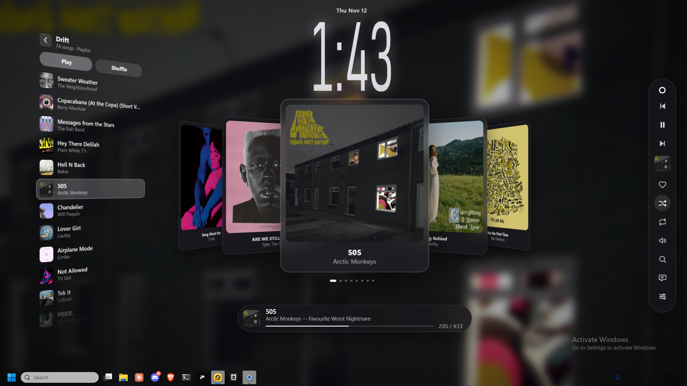
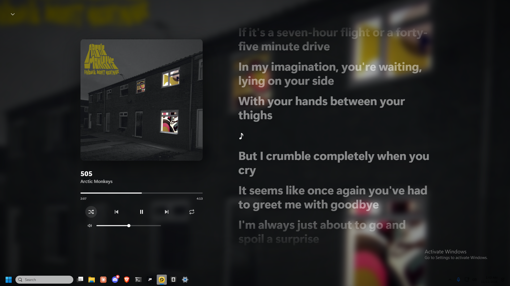
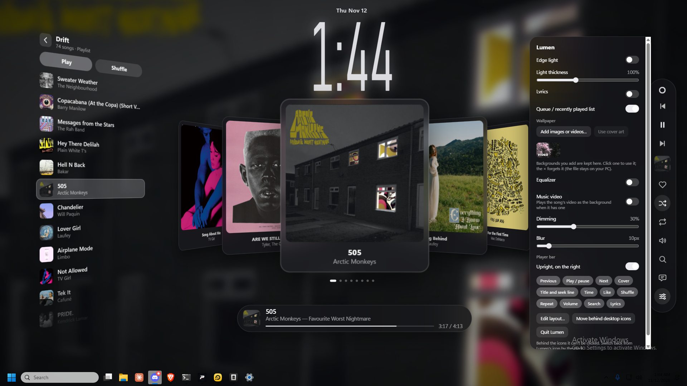

# Lumen

A music player that is also the wallpaper. Windows 11, Electron, one frameless window
pinned to the desktop layer: a blurred backdrop, a tall clock, a fan of covers, a queue,
a player bar, and a light around the edge of the screen that takes its colour from the
artwork and moves with the beat.



<table>
<tr>
<td></td>
<td></td>
</tr>
<tr>
<td>Word-by-word lyrics, timed by the linked player</td>
<td>One panel for every layer</td>
</tr>
</table>

It is not a window you alt-tab to. It sits under everything, on the desktop, and you
work on top of it.

```
wallpaper  ->  desktop layer, one full-bleed window
player     ->  a bar you can turn upright, and take apart piece by piece
clock      ->  the loudest object by day, dims when something is playing
```

## What it does

- **Backdrop.** Any image or video, kept in a vault of thumbnails. Dim and blur are
  separate sliders, and both apply to the artwork too when it is standing in as the
  backdrop.
- **Edge light.** A ring of colour around the screen edge, sampled from the cover art
  and driven by the audio: it reacts to what is actually coming out of the speakers,
  not to a timer.
- **Cover fan.** The playing track in front, the rest receding behind it. Wheel, drag
  or click to move through the queue; it drifts back to the playing track when left
  alone.
- **Queue and playlists.** The list on the left follows whichever source is live.
- **Player bar.** Horizontal or upright on the right. Any part of it can be switched
  off: previous, play, next, cover, title and seek, time, like, shuffle, repeat,
  volume, search, lyrics.
- **Lyrics.** Word-by-word when the linked player supplies word timings, line-by-line
  from LRCLIB when it does not.
- **Music video.** When the playing track has a video, it can play muted as the
  backdrop instead of the still image.
- **Layout editor.** Move and resize every part independently. Double-click resets a
  part, the placement is saved.
- **Tray menu.** Everything above, plus pinning the window back to the desktop layer
  after Explorer restarts or the display changes.

## Two sources of music

Lumen runs on whichever it can get:

| source | what you get |
| --- | --- |
| **Linked player** | queue, search, picking songs, playlists, suggestions, likes, volume, word-timed lyrics |
| **Windows now-playing** | one track, play, pause, skip, seek |

The linked player is optional and is not named in this repository: the app talks to it
over a loopback protocol (`docs/engine-protocol.md`) and finds it through
`engine.config.json`. Without that file Lumen starts on the Windows fallback and
everything except the queue and search still works.

The fallback reads the same media session the hardware media keys drive, so Spotify, a
browser tab, or anything else that publishes a media session shows up there.

## Run

Requires Node.js 20 or newer, once, to fetch the Electron runtime.

```powershell
powershell -ExecutionPolicy Bypass -File setup.ps1   # downloads Electron to %LOCALAPPDATA%\Lumen\runtime
.\Start Lumen.cmd                                    # or double-click it
```

`setup.ps1` keeps the runtime outside the repo so a few hundred MB of binaries never
end up in OneDrive or in git.

To start with Windows, put a shortcut to `Start Lumen.cmd` in `shell:startup`.

## Configure the engine

Copy `engine.config.example.json` to `engine.config.json` and fill it in:

```json
{
  "processName": "player",
  "exePath": "%LOCALAPPDATA%\\Programs\\player\\player.exe",
  "windowClass": "Chrome_WidgetWin_1",
  "appId": "engine",
  "coverHosts": ["ytimg.com", "ggpht.com", "googleusercontent.com", "sndcdn.com"]
}
```

| field | meaning |
| --- | --- |
| `processName` | process name without `.exe`, as Task Manager shows it |
| `exePath` | absolute path to start the player from; `%VARS%` are expanded |
| `windowClass` | window class of the player's main window, for hide/show |
| `appId` | value recorded on every track that comes from the engine |
| `coverHosts` | hostnames cover art may be fetched from, so its pixels can be read for the edge light |

`engine.config.json` is gitignored. With an empty config the engine is simply not
started, and Lumen stays on the Windows fallback.

## Files

```
src/main.js              window, tray, settings, IPC, command routing
src/bridge.js            loopback server: command stream out, state in, page + media serving
src/engine.js            start/hide/show/close the linked player (config driven)
src/attach.js            pin the window to the desktop layer
src/nowplaying.js        Windows media session fallback
src/lyrics.js            LRCLIB lookup for the fallback
src/preload.js           the only bridge into the page
src/renderer/app.js      the scene: clock, fan, list, bar, search, lyrics, layout
src/renderer/edge.js     the edge light
src/renderer/beat.js     audio analysis for the light and the pulse
src/renderer/color.js    palette extraction from the cover
src/renderer/lyrics.js   LRC parsing and word timing
src/renderer/style.css   everything visual
helpers/enginewindow.ps1 Win32 window hide/show/close for the linked player
helpers/nowplaying.ps1   WinRT media session reader
player-page/index.html   a bare YouTube embed page, framed for the video backdrop
docs/                    protocol and design notes
```

Settings, history and a small log live in `%APPDATA%\lumen`.

## How the pieces fit

1. `main.js` starts the window, the tray, and the loopback server.
2. The page is loaded either from that server (`http://127.0.0.1:38917/app/`) or from
   disk, depending on whether the port is free.
3. A linked player connects to `/to-engine`, receives commands as server-sent events,
   and posts its state back to `/from-engine`.
4. If no player connects, `nowplaying.ps1` supplies state instead.
5. Audio for the edge light and the pulse comes from loopback capture of the system
   output. The microphone is never touched and nothing is recorded.

## Limits

- Primary monitor only.
- Clickable mode covers desktop icons and the desktop context menu. Pinned behind the
  icons it is display-only, because Windows does not deliver clicks to that layer.
- It keeps drawing while other windows cover the desktop, by design.
- Search finds songs. Albums, artists and playlists are not browsable here.
- The fallback source cannot browse a queue: one track, transport controls, seek.
- The music video backdrop needs the page to be served from the local server, because
  the video platform refuses its player on `file://`.

## Licence

MIT. See `LICENSE`.

## Contributors

- [HotShotv](https://github.com/HotShotv) — the app
- Claude — engine abstraction, protocol docs, packaging

See `CONTRIBUTORS.md`.
